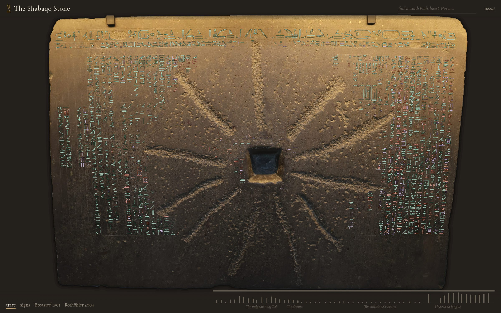
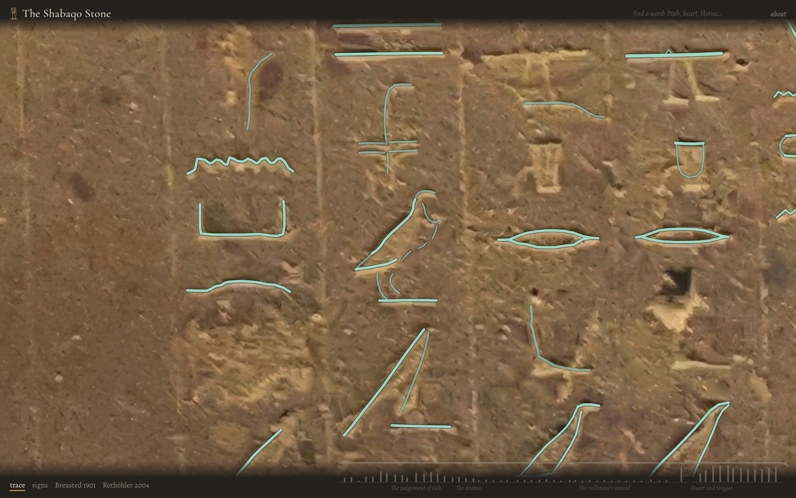
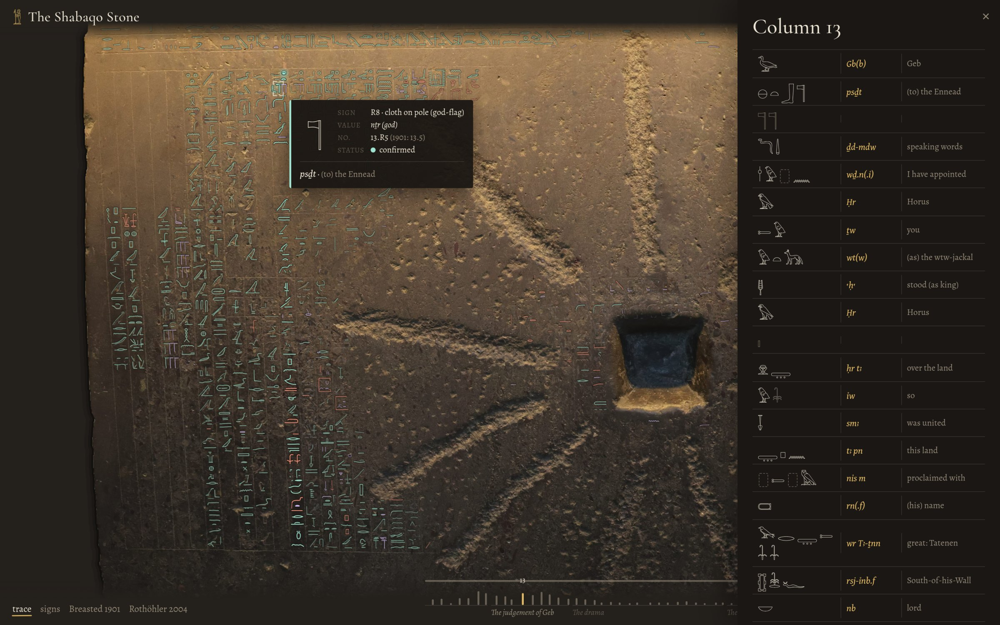
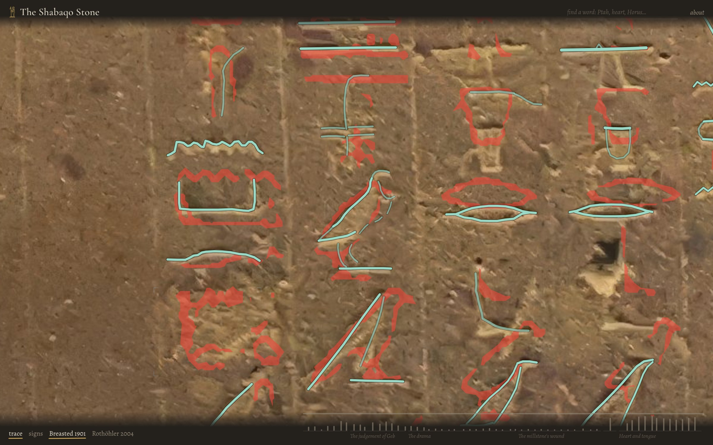
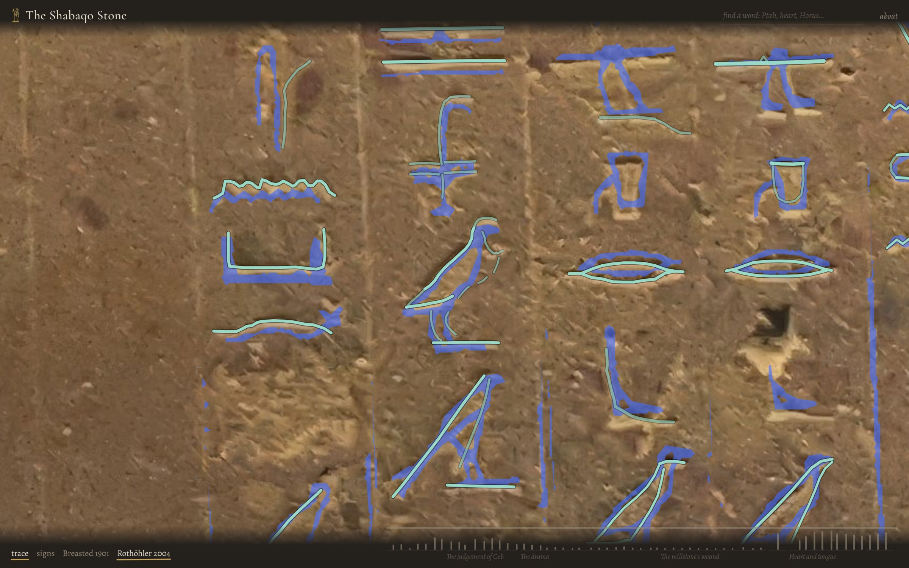

# The Shabaqo Stone: a sign-by-sign trace

An interactive edition of the inscription on the Shabaqo Stone (British Museum EA 498), with every
surviving sign traced stroke by stroke on a high-resolution photograph of the stone, numbered after
Rothöhler (2004), and compared with Breasted's hand copy of 1901.

**Viewer:** <https://brezgis.github.io/shabaqo/>



## The monument

The slab was inscribed for Shabaqo of the Twenty-fifth Dynasty around 710 BC. Its dedication (line 2)
says that the king found a work of the ancestors that worms had eaten and had it copied anew in stone. The
text it preserves, conventionally called the *Memphite Theology*, tells how Geb judged between Horus and
Seth and how Ptah created the world through heart and tongue. The centre of the inscription is effaced by
a square socket and radiating grooves. These are usually explained by later reuse as a millstone, an
explanation El Hawary has questioned. The king's names in line 1 were hacked out in antiquity.

## What the edition contains

The sign list follows Rothöhler's facsimile (Tafel 1). It has 2,063 signs in 59 units: the horizontal
lines 1–2 and columns 3–64 (columns 48–52 are a single unit). Every sign in the list has a recorded outcome:

| Outcome | Signs |
|---|---:|
| Traced on the stone (4,356 strokes) | 1,892 |
| Recorded as empty (surface lost, or a restoration not supported by the stone), with the reason | 65 |
| Lost, as in Rothöhler's facsimile | 99 |
| Rejected as not on the stone | 6 |
| Merged into a neighbouring sign | 1 |

Each traced sign is also compared with Breasted's copy. In the viewer these comparisons appear as colours
(counts are of viewer records):

| Status | Meaning | Signs |
|---|---|---:|
| confirmed | the stone agrees with Breasted | 1,321 |
| corrected | the stone shows a different sign or form | 324 |
| added | on the stone, but not in Breasted's copy | 247 |
| not visible | in Breasted's copy, but not visible on the stone | 164 |

The text is also read word by word: 603 words with transliteration and English gloss. These readings
are **provisional** (see [Limitations](#limitations)).

| | |
|---|---|
|  |  |
| The trace at close range: centre lines of the carved grooves | A column opened word by word, with the sign under the pointer identified |
|  |  |
| Breasted's copy of 1901 (red) over the trace | Rothöhler's facsimile (blue) over the trace |

## Method

**Photographs.** The main photograph was taken in the gallery and upscaled by the photographer. Two
independent photographs, not upscaled, serve as a check. A relief map is computed from each source; it
brings out the carved grooves. The relief from the independent photographs is used to reject strokes
that appear only in the upscaled image and could be upscaling artefacts.

**Sign kits.** For every sign a kit is cut from these sources: the photograph, both relief maps, a
coordinate grid with the neighbouring signs marked, a wider context view, and Rothöhler's drawing of the
sign. His plate is mapped onto the photograph region by region, using the column labels printed on the
plate, and a per-region drift correction is fitted from the traces already made.

**Tracing.** Each sign is traced by an AI agent (Anthropic's Claude Opus) working from its kit, under the
author's direction. The written briefs are in [`docs/method/`](docs/method/). A trace records the centre
line of each carved groove at the groove's measured width. Each stroke is graded as clearly cut, worn
but visible, or restored. The agent renders its trace back over the photograph and corrects it, usually
over two to four rounds. Automatic checks then score how well each stroke sits in its groove and flag
overlaps and other inconsistencies. These checks are used as diagnostics, not as targets.

**Authority.** The stone takes precedence, then Rothöhler's facsimile, then Breasted's copy. Where the
facsimile and the carving disagree in position, signs are matched by their order in the column.
Disagreements with either published copy are recorded per sign. They were reviewed in a separate fix-up
pass, and the remaining editorial decisions are recorded in the sign list.

**Numbering.** A sign's number is `<unit>.R<k>`, meaning the *k*-th sign of that unit in Rothöhler's
sequence. Where a sign also has a number in Breasted's 1901 sequence, that number is kept as `alias`.

## Limitations

- This is an independent, amateur collation made from photographs, not a critical edition. It has not
  been peer reviewed.
- All photographs were taken under the gallery's overhead light, which favours horizontal cuts. Some
  vertical strokes are therefore hard to see, and so are shallow cuts that face the light.
- The main photograph was upscaled with AI. The independent relief maps limit the risk of tracing
  upscaling artefacts but do not remove it.
- The transliterations and glosses were drafted with reference to Breasted (1901), Bryant and Read
  (1901) and Sethe (1928). They have not yet been revised against the new sign list.
- Open questions: a faint mark under the swallow in column 14 (`14.18`), which Rothöhler does not draw;
  grooves in columns 57, 58, 59 and 61, and three isolated cuts near `27.1`, which he also does not draw;
  and low-confidence identifications at `15.29` and `18.17`/`18.18`.

For scholarly work see Sethe (1928), Rothöhler (2004) and El Hawary (2010).

## The viewer

The viewer is a static site with no build step. To run it locally:

```sh
python3 -m http.server 8000
# then open http://localhost:8000/
```

Hover over a sign to identify it, and click it to open its column word by word. The strip beneath the
stone maps the columns in place, and the height of each mark shows how much of that column survives.

Keys:

| Key | Action |
|---|---|
| `t` | Trace |
| `g` | Typeset signs |
| `b` | Breasted 1901 |
| `r` | Rothöhler 2004 |
| `←` `→` | Previous / next column |
| `/` | Search |

Search accepts English glosses ("heart"), transliterations, with or without diacritics ("ḏd", "dd"),
and Gardiner codes ("G7").

The photograph is shown with [OpenSeadragon](https://openseadragon.github.io/) as deep-zoom tiles. The
trace is drawn on a canvas over the photograph, in two ways:

- **Zoomed out:** the trace comes from one prerendered bitmap of the whole stone, with mipmaps.
- **Zoomed in:** the visible area plus a margin is rendered, with strokes batched by spatial chunk and style.

While the view moves, the last drawing is moved and scaled by the browser's compositor instead of being
redrawn, and an exact redraw follows once the view is still. Breasted's and Rothöhler's copies are
fetched only when first switched on. Append `?bench` to the URL for a scripted pan-and-zoom benchmark.

## Data

All coordinates are pixels of the full-resolution photograph (11,448 × 7,452).

| File | Contents |
|---|---|
| `dataset/stone_full.json` | The complete edition: units (title, section, translation, words with transliteration, gloss and sign list) and signs with strokes and the tracer's notes |
| `dataset/signlist_rothoehler.json` | The sign list in Rothöhler's sequence: per sign its number, 1901 alias, Gardiner code, his description, outcome (`traced`, `empty`, `lost`, `rejected`, `merged`) and box |
| `data/stone.json` | The viewer's subset of `stone_full.json` |
| `data/breasted.json` | Breasted's copy as polygons |
| `data/roth_copy.json` | Rothöhler's copy as polygons |
| `data/stone_cutout.json` | Outline of the slab |
| `tiles/` | Deep-zoom tiles of the photograph |

A sign record in `stone_full.json` looks like this:

```json
{
  "sid": "13.R5", "alias": "13.5", "unit": "13", "gardiner": "R8", "status": "confirmed",
  "box": [x0, y0, x1, y1],
  "strokes": [{"d": [x, y, x, y, ...], "w": 2.1, "c": "c", "z": 0}],
  "trace_notes": "..."
}
```

Stroke fields:

| Field | Meaning |
|---|---|
| `d` | The groove's centre line, as a flat list of points |
| `w` | Groove width |
| `c` | Grade: `c` clearly cut, `f` worn but visible, `r` restored |
| `z` | `1` if the stroke is a closed path |

The pipeline scripts in [`scripts/`](scripts/) are a record of the method: kits, mapping of the
facsimile, quality checks, numbering and data assembly. They are not runnable as they stand, because they
expect the working photographs and intermediate files, which are not part of this repository.

## Sources

- Photograph: [Sanjay ach](https://commons.wikimedia.org/wiki/File:Shabaka_Stone_at_the_British_Museum.jpg),
  Wikimedia Commons, CC BY-SA 4.0 (upscaled by the photographer).
- Independent photographs:
  [British_Museum_2024-10-03v](https://commons.wikimedia.org/wiki/File:British_Museum_2024-10-03v.jpg)
  (CC BY-SA 4.0) and
  [ShabakaStone-BritishMuseum-August19-08](https://commons.wikimedia.org/wiki/File:ShabakaStone-BritishMuseum-August19-08.jpg)
  (CC BY 2.5), Wikimedia Commons.
- J. H. Breasted, "The Philosophy of a Memphite Priest", *Zeitschrift für Ägyptische Sprache und
  Altertumskunde* 39 (1901), 39–54, pls. I–II.
- S. Bryant and F. W. Read, *Proceedings of the Society of Biblical Archaeology* 23 (1901), 160–187.
- K. Sethe, *Dramatische Texte zu altägyptischen Mysterienspielen* I (Leipzig, 1928).
- B. Rothöhler, *Neue Gedanken zum Denkmal memphitischer Theologie*, Dissertation, Universität
  Heidelberg (2004), Tafel 1.
- A. El Hawary, *Wortschöpfung: Die Memphitische Theologie und die Siegesstele des Pije* (Fribourg and
  Göttingen, 2010).

## Licence

- **Code** (`app.js`, `index.html`, `style.css`, `scripts/`): MIT; see [`LICENSE`](LICENSE).
- **Photograph tiles, trace and dataset:** CC BY-SA 4.0. They derive from the CC BY-SA 4.0 photograph.
- **Breasted's copy:** public domain.
- **Rothöhler's copy** (`data/roth_copy.json`): a vectorised reproduction of Tafel 1 of his dissertation,
  included for scholarly comparison. Rights remain with the author.

## Citation

> Brezgis, Anna. *The Shabaqo Stone: a sign-by-sign trace.* 2026. https://github.com/brezgis/shabaqo
